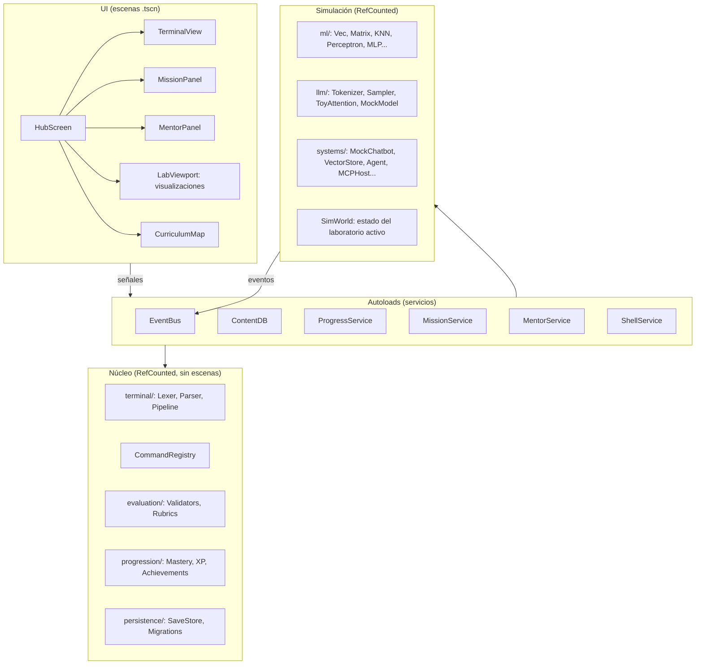
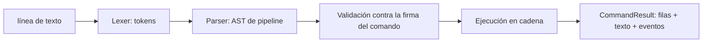
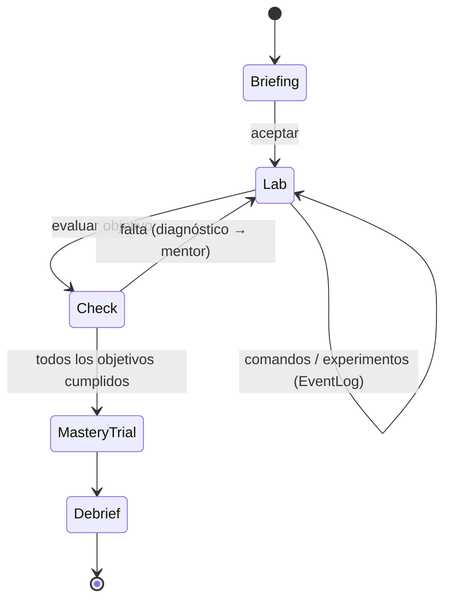

# 02 — Arquitectura Godot

Godot 4.7.x · GDScript con tipado estático (`var x: int`, `func f() -> void`).

## 1. Principios

1. **La lógica no depende de las escenas.** Los sistemas del núcleo son clases `RefCounted` puras (con `class_name`), testeables sin abrir ninguna ventana. Las escenas solo **muestran** y **reenvían** acciones.
2. **El contenido no es código.** Módulos, misiones, pistas, glosario y referencias viven en JSON dentro de `content/`.
3. **La comunicación se hace por eventos, no por referencias cruzadas.** Los sistemas emiten señales en un `EventBus` y se registran en un `EventLog` que usa el evaluador.
4. **Ningún acceso al mundo exterior.** Un test lo verifica (ver §9).
5. **Composición antes que herencia** para los comandos, los validadores y las simulaciones (patrón *registry*).

> 🎓 **Concepto Godot — Autoload.** Un autoload es un nodo que Godot crea al arrancar y que es accesible globalmente por su nombre (Proyecto → Configuración → Autoload). Lo usaremos **solo** para servicios de vida global. Abusar de los autoloads crea acoplamiento oculto, así que lo limitaremos a 6.

## 2. Vista de capas



## 3. Estructura de carpetas

```
AI Ronin/
├─ docs/                      # Diseño (estos documentos)
├─ game/                      # Proyecto Godot (project.godot aquí)
│  ├─ project.godot
│  ├─ autoload/               # EventBus, ContentDB, ProgressService, MissionService, MentorService, ShellService
│  ├─ core/
│  │  ├─ terminal/            # lexer.gd, parser.gd, pipeline.gd, command.gd, command_registry.gd, completion.gd
│  │  ├─ commands/            # un fichero por familia: help_cmds.gd, dataset_cmds.gd, model_cmds.gd...
│  │  ├─ missions/            # mission_def.gd, objective.gd, mission_state.gd
│  │  ├─ evaluation/          # validator.gd + validators/*.gd, rubric.gd, diagnostic.gd
│  │  ├─ mentor/              # hint_ladder.gd, socratic.gd
│  │  ├─ progression/         # mastery.gd, xp.gd, achievements.gd, review_scheduler.gd
│  │  └─ persistence/         # save_store.gd, migrations.gd, evidence_importer.gd
│  ├─ sim/
│  │  ├─ ml/                  # vec.gd, matrix.gd, dataset.gd, knn.gd, perceptron.gd, linreg.gd, mlp.gd, metrics.gd
│  │  ├─ llm/                 # bpe_tokenizer.gd, sampler.gd, toy_attention.gd, mock_model.gd
│  │  ├─ systems/             # mock_chatbot.gd, vector_store.gd, agent.gd, mcp_host.gd, ...
│  │  └─ sim_world.gd
│  ├─ ui/
│  │  ├─ hub/                 # hub_screen.tscn/.gd
│  │  ├─ terminal/            # terminal_view.tscn/.gd
│  │  ├─ panels/              # mission_panel, mentor_panel, cheatsheet_panel, curriculum_map
│  │  ├─ viz/                 # scatter_plot, confusion_matrix, network_graph, attention_heatmap...
│  │  └─ theme/               # ronin_theme.tres, fuentes
│  ├─ content/
│  │  ├─ curriculum.json      # pistas, arcos, competencias y dependencias
│  │  ├─ missions/T1-01/      # mission.json + datasets/*.csv
│  │  ├─ glossary.json
│  │  ├─ cheatsheets.json
│  │  ├─ manual/              # temas de `man` (markdown ligero)
│  │  └─ references.json
│  └─ tests/
│     ├─ run_tests.gd         # runner propio (SceneTree headless)
│     ├─ test_case.gd
│     └─ unit/                # test_parser.gd, test_knn.gd, test_isolation.gd...
└─ forja/                     # Laboratorios reales (Python/Docker), fuera del proyecto Godot
   ├─ README.md
   ├─ p0-python/              # pista de Python para IA
   └─ labs/A1-chatbot/...     # compose.yaml, app/, evidence/
```

> ¿Por qué el proyecto Godot vive en `game/` y no en la raíz? Para que Godot no importe ni escanee la carpeta `forja/`, con sus entornos virtuales de Python y sus modelos de varios GB.

## 4. Autoloads (servicios)

| Autoload | Responsabilidad | No hace |
|---|---|---|
| `EventBus` | Señales globales (`mission_started`, `command_executed`, `sim_event`, `hint_requested`…) | Ningún tipo de lógica |
| `ContentDB` | Carga y valida el JSON de `content/`, e indexa misiones, glosario y referencias | Escribir |
| `ProgressService` | Fachada sobre `SaveStore`, `Mastery` y `XP`; guarda en `user://` | Decidir si un objetivo se ha cumplido |
| `MissionService` | Ciclo de vida de la misión: cargar → briefing → laboratorio → evaluar → debrief; mantiene el `EventLog` | Pintar la UI |
| `MentorService` | Escalera de pistas, diagnósticos → mensajes, preguntas de predicción | Resolver la misión |
| `ShellService` | Recibe líneas del terminal, ejecuta el pipeline y devuelve la salida | Tocar el sistema operativo |

## 5. Terminal

### 5.1 Flujo



### 5.2 Decisión clave: los pipes pasan datos estructurados

Los pipes no pasan texto, como en bash. Pasan **filas estructuradas** (`Array[Dictionary]`), como en PowerShell. Así `where`, `sort`, `select` y `stats` funcionan igual para cualquier dato (datasets, resultados de búsqueda RAG, registros de agentes), y el terminal **enseña a pensar en datos**.

```
dataset show iris | where species=setosa | select petal_len,petal_w | stats
```

### 5.3 Contrato de un comando

```gdscript
class_name Command extends RefCounted

func get_name() -> String: return ""
func get_signature() -> CommandSignature: return null  # args, flags, tipos, descripción
func get_unlock_tier() -> int: return 0               # 0: simple · 1: flags · 2: pipes · 3: scripts
func execute(ctx: CommandContext, input_rows: Array) -> CommandResult: return null
```

- `CommandContext` da acceso **solo** al `SimWorld` y al `EventBus`, nunca a `OS` ni a `FileAccess` (salvo que el comando lea `res://content`).
- Si un comando está bloqueado, se muestra igualmente en `help` como «🔒 se desbloquea en…». Su `--help` funciona siempre.

### 5.4 Ayuda siempre disponible

| Comando | Qué hace |
|---|---|
| `help` · `help <cmd>` · `<cmd> --help` | Firma, ejemplos y errores típicos |
| `man <tema>` | Manual conceptual (por ejemplo, `man knn`, `man pipes`) |
| `cheatsheet [tema]` | Chuleta generada a partir de lo que ya has visto |
| `explain <término>` | Glosario, con la etiqueta epistemológica |
| `hint` | Siguiente nivel de la escalera de pistas |
| `<línea> ?` | Sugerencias contextuales sin ejecutar nada |
| `history`, Tab, ↑↓ | Historial y autocompletado |

### 5.5 Scripts `.rsh` (nivel 3)

Son secuencias de comandos con variables simples (`$k = 3`) y un `for` sobre listas. **No es un lenguaje de propósito general:** no hay llamadas a GDScript ni `Expression`.

> ⚠️ **Seguridad.** La clase `Expression` de Godot puede invocar métodos de objetos. Para un evaluador de expresiones aritméticas escribiremos un parser propio, pequeño y con una lista blanca de operaciones.

## 6. Motor de misiones y evaluación

### 6.1 Ciclo de vida



### 6.2 Validadores

- Un objetivo declara en JSON **qué evidencia** demuestra que se ha cumplido.
- El validador consulta el `EventLog` y el `SimWorld`, y devuelve un resultado `{passed, diagnostic_code, data}`.

Tipos iniciales:

| Tipo | Ejemplo |
|---|---|
| `event` | Se ha emitido `model.evaluated` con `split=test` y `accuracy >= 0.9` |
| `state` | `SimWorld.models.knn.k` está entre 3 y 9 |
| `sequence` | `dataset split` ocurre **antes** de `model train` |
| `answer` | Valor numérico con tolerancia (por ejemplo, «¿cuál es la distancia euclídea?»), nunca un test de opciones |
| `prediction` | Has registrado una predicción **antes** del experimento (no se evalúa si acertaste) |
| `evidence` | Evidencia importada de la Forja que cumple el esquema y las condiciones |
| `rubric` | Informe estructurado con los campos y criterios requeridos |

Los **códigos de diagnóstico** (por ejemplo, `DATA_LEAKAGE_TEST_USED_IN_TRAINING`) los define cada misión, y el mentor los traduce a explicaciones y preguntas.

## 7. Mentor RONIN

- `HintLadder`: 5 niveles por objetivo. El nivel siguiente solo se ofrece tras pedirlo de forma explícita. El nivel 5 exige confirmación («Ver el ejemplo resuelto reduce la maestría de esta competencia. ¿Continuar?»).
- `Socratic`: preguntas asociadas a cada diagnóstico, del tipo «¿qué datos ha visto el modelo durante el entrenamiento?».
- Reglas de silencio: RONIN no interrumpe mientras estás experimentando. Habla en momentos concretos:
  - Al abrir el laboratorio.
  - Tras un error repetido.
  - Cuando lo llamas.
  - En el debrief.
- **Sin LLM** dentro del Dojo. Es una decisión de aislamiento, no una limitación técnica.

## 8. Progresión y persistencia

- `Mastery`:
  - Por competencia: estado (`vista`, `practicada`, `dominada`, `transferida`) y puntuación de 0 a 100.
  - La puntuación se pondera según el nivel máximo de pista usado.
- `XP`:
  - Se gana con eventos de aprendizaje: hipótesis nueva, primer experimento distinto, objetivo cumplido sin pistas, transferencia.
  - Repetir da poco XP, con rendimientos decrecientes.
- `ReviewScheduler`: programa las revisiones espaciadas de las competencias dominadas (intervalos 1 → 3 → 7 → 21 días).
- `SaveStore`:
  - Guarda en `user://save.json` con `schema_version`.
  - Escritura atómica: se escribe un `.tmp` y después se renombra.
  - Copia `.bak` de la versión anterior.
  - `Migrations` aplica una función por cada salto de versión.
- `EvidenceImporter`:
  - Lee un JSON elegido por ti con `FileDialog`.
  - Valida su esquema y lo copia a `user://evidence/`.
  - Nunca ejecuta nada.

## 9. Tests

- **Runner propio** (`tests/run_tests.gd`, unas 80 líneas), en lugar de GUT o gdUnit4. Así no hay dependencias y entiendes cómo funciona un framework de tests.
- Se ejecuta en modo headless:
  ```bash
  "C:\Users\Ruben\Desktop\Godot_v4.7.2-stable_win64.exe" --headless --path game -s res://tests/run_tests.gd
  ```
- Prioridades:
  1. Parser y pipeline del terminal.
  2. Algoritmos de ML, comparados con valores calculados a mano.
  3. Validadores.
  4. Maestría y XP.
  5. Migraciones del guardado.
  6. **Test de aislamiento:** busca en los `.gd` del Dojo cualquier API prohibida (`HTTPRequest`, `HTTPClient`, `StreamPeerTCP`, `PacketPeerUDP`, `WebSocketPeer`, `TCPServer`, `UDPServer`, `OS.execute`, `OS.create_process`, `OS.shell_open`, `OS.execute_with_pipe`).
- Más adelante: un workflow de GitHub Actions que ejecute los tests en cada push. Corre en GitHub, no en el Dojo.

## 10. Cómo se amplía

| Quiero añadir… | Hago… |
|---|---|
| Una misión con validadores existentes | Una carpeta en `content/missions/` con `mission.json` y datos |
| Un comando nuevo | Una clase que extienda `Command` y su registro en la familia |
| Un tipo de validador | Una clase que extienda `Validator` y su registro por `type` |
| Una simulación | Una clase en `sim/systems/`, un componente de visualización opcional y comandos |
| Un laboratorio de la Forja | Una carpeta en `forja/labs/`, el esquema de `evidence.json` y un validador `evidence` en la misión |
| Actualizar una referencia | Editar `references.json` (versión, fecha y `review_by`) |

## 11. Conceptos de Godot que aprenderás en cada fase

| Fase | Conceptos |
|---|---|
| Núcleo | `class_name`, `RefCounted` frente a `Node`, tipado estático, señales, autoloads, `FileAccess`, `JSON`, `user://` frente a `res://` |
| UI | Nodos `Control`, contenedores (`VBoxContainer`, `HSplitContainer`), anclas, `Theme` y variaciones de tema, `RichTextLabel` con BBCode, `LineEdit` y `_gui_input` |
| Visualización | `_draw()` personalizado, `queue_redraw()`, `Tween`, shaders `canvas_item` sencillos |
| Tests | `SceneTree` como script principal, modo headless, códigos de salida |
| Distribución | Plantillas de exportación, `export_presets.cfg` y firma de ejecutables (opcional) |
