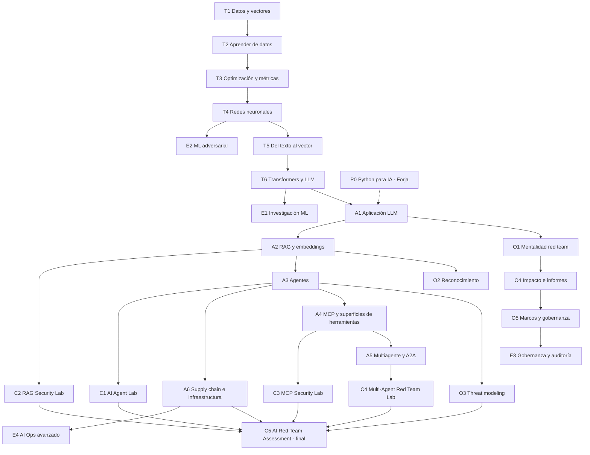

# 03 — Currículo y mapa de dependencias

## 1. Análisis crítico de la propuesta original

### 1.1 Lo que ya estaba contemplado
- **M01–M04, M07, M08, M11 y M13** cubren casi toda la parte de **AI Engineering** de la ampliación.
- **M09 y M10** cubrían buena parte de **AI Security**: prompt injection, jailbreak, system prompt leakage, RAG poisoning, tool abuse, excessive agency, supply chain, OWASP y MITRE ATLAS.
- **M12** cubría la gobernanza: AI Act, ISO/IEC 42001 y NIST AI RMF.

### 1.2 Lo nuevo que aporta la ampliación
- **Reconocimiento** de objetivos de IA.
- **Multiagente y A2A:** suplantación de agentes, manipulación de mensajes, explotación de la confianza entre agentes.
- **Ataques a embeddings:** inversión y extracción de información.
- **Envenenamiento de memoria de agentes** y **confused deputy.**
- **Seguridad de los pesos del modelo** y de los adapters.
- **Infraestructura:** model serving, contenedores, cloud y GPU.
- **AI Operations completo:** CI/CD, monitorización, secretos y control de acceso.
- **Evaluación por competencias** demostradas.
- **Proyectos integradores.**
- **Laboratorios reales.**

### 1.3 Duplicidades detectadas
- Prompt injection aparece en M05, M09 y M10.
- RAG aparece en M06, M09 y M10.
- Los agentes aparecen en M08, M09 y M10.
- MCP aparece en M11, M09 y M10.
- Embeddings aparecen en M04 y M06.
- Gradient descent aparece en M02 y M03.
- Transformers aparecen en M03 y M04.

**La causa** es que el temario se organizaba **por disciplinas**. M09 y M10 se convertían en cajones que repetían todos los sistemas.

### 1.4 Reorganización propuesta
El currículo se organiza **por sistemas**. Cada sistema se recorre **una sola vez**, con sus cuatro caras: **Construir → Atacar → Defender → Desplegar.**

## 2. Estructura

```
TRONCO COMÚN (obligatorio)   T1 → T6           Fundamentos: datos, ML, redes, LLM
PISTA P0 (Forja, paralela)   Python para IA    Obligatoria antes del primer lab Forja
ARCOS DE SISTEMA             A1 → A6           Cada uno: Construir · Atacar · Defender · Desplegar
PISTA DE OFICIO (transversal) O1 → O5          Metodología red team, recon, threat modeling, informes, marcos
ESPECIALIZACIONES (opcional) E1 → E4           Investigación ML, ML adversarial, gobernanza, AI Ops avanzado
CAPSTONES                    C1 → C5           Proyectos integradores
```

## 3. Mapa de dependencias



Regla de desbloqueo: un nodo se desbloquea cuando todas las **competencias** marcadas como requisito están en estado **Dominada**. Completar misiones no basta.

## 4. Tronco común (Dojo, con ML real en GDScript)

Las matemáticas se introducen **justo a tiempo**, solo cuando la misión las necesita.

| Id | Unidad | Conceptos | Matemáticas justo a tiempo | Laboratorio (real en GDScript) |
|---|---|---|---|---|
| T1 | Datos y vectores | Dataset, feature, label, vector, distancia, normalización, IA simbólica frente a ML | Vectores, norma, distancia euclídea y coseno, media y desviación típica | Inspeccionar un dataset sintético, normalizar y medir distancias |
| T2 | Aprender de datos | Supervisado, no supervisado y por refuerzo (mapa); clasificación y regresión; train/val/test; overfitting y underfitting | Proporciones, probabilidad básica | k-NN, efecto de k, k-means, fuga de datos |
| T3 | Optimización y métricas | Función de pérdida, gradient descent, learning rate, regresión lineal y logística, precision, recall, F1, matriz de confusión, ajuste de hiperparámetros | Derivada como pendiente, gradiente, sigmoide | Visualizar el descenso por gradiente; ajustar el umbral y su compromiso entre precision y recall |
| T4 | Redes neuronales | Neurona, pesos y bias, activaciones, forward pass, backpropagation, MLP; CNN y RNN como mapa conceptual | Producto matricial, regla de la cadena | MLP que aprende XOR; tocar pesos a mano; ver cómo fluye el gradiente |
| T5 | Del texto al vector | Tokenización (BPE), vocabulario, embeddings, similitud semántica | Producto escalar, similitud coseno | Entrenar un BPE de juguete; espacio de embeddings 2D; vecinos semánticos |
| T6 | Transformers y LLM | Self-attention, Q/K/V, contexto, next-token prediction, temperature, top-k y top-p, ventana de contexto, pretraining, fine-tuning, RLHF (conceptual), quantization, modelos de pesos abiertos frente a cerrados | Softmax, probabilidad condicional | Atención de juguete calculada; sampling real sobre distribuciones; truncado de contexto |

*Etiquetas:* T1–T4 son `consolidado`. En T6, las cifras y las prácticas de los modelos comerciales son `práctica-industria` y llevan fecha.

### P0 — Python para IA (Forja, paralela al tronco)
1. Sintaxis, estructuras de datos, funciones y módulos.
2. Entornos virtuales y pip.
3. JSON, HTTP con `httpx` y `async` básico.
4. Ejercicios con autocorrección local (pytest). **Se escriben con tus manos.**

Es requisito para los laboratorios Forja de A1.

## 5. Arcos de sistema

Cada arco tiene 4 fases con laboratorio en el Dojo (mecanismo) y en la Forja (realidad). Las referencias son las versiones vigentes en noviembre de 2026; ver §8.

### A1 — Aplicación LLM (chatbot)
- **Construir:**
  - API de chat (roles system, user y assistant).
  - System prompt.
  - Plantillas.
  - Structured output y su validación.
  - Gestión de contexto.
  - Prompt engineering: few-shot, descomposición, instrucciones robustas.
  - Evaluación con un conjunto de pruebas.
- **Atacar:**
  - Direct prompt injection.
  - Jailbreaking.
  - System prompt extraction.
  - Sensitive information disclosure.
  - Improper output handling (salida renderizada o ejecutada sin validar).
  - Unbounded consumption.
- **Defender:**
  - Separación entre instrucciones y datos.
  - Validación de entrada y salida.
  - No guardar secretos en el prompt.
  - Codificación de la salida.
  - Límites de uso.
  - Evaluación adversarial **antes y después**.
- **Desplegar:**
  - API segura.
  - Autenticación y rate limiting.
  - Gestión de secretos.
  - Logging sin datos sensibles.
- **Forja:**
  - FastAPI con un LLM local (1–3B, CPU).
  - Chatbot vulnerable a propósito, atacarlo y endurecerlo.
- **Referencias:** OWASP LLM01, LLM02, LLM05, LLM07 y LLM10 (2025). AI-300: bloque 1.

### A2 — RAG y embeddings
- **Construir:**
  - Ingesta y extracción de texto.
  - Chunking: tamaño y solapamiento.
  - Embeddings.
  - Base vectorial y búsqueda por similitud.
  - Búsqueda híbrida (BM25 más vectores).
  - Reranking.
  - Ensamblado del contexto.
  - Evaluación de recuperación (recall@k) y de fidelidad.
- **Atacar:**
  - Indirect prompt injection en documentos.
  - RAG poisoning.
  - Manipulación de la recuperación (documentos optimizados para posicionarse).
  - Fuga de datos entre usuarios o tenants por falta de ACL.
  - **Embedding inversion e information extraction.** En la Forja: reconstrucción aproximada de texto a partir de vectores. Lleva la etiqueta `investigación-experimental` y se citan los papers.
- **Defender:**
  - Control de acceso en la recuperación.
  - Procedencia y firma de documentos.
  - Sanitización y marcado de contenido no confiable.
  - Tratar los embeddings como **datos sensibles**.
  - Monitorización de la recuperación.
- **Desplegar:**
  - Seguridad de la base vectorial: autenticación, red y cifrado.
  - Pipelines de ingesta.
- **Referencias:** OWASP LLM08, LLM04 y LLM01. AI-300: bloques 5 y 6.

### A3 — Agentes (herramientas y memoria)
- **Construir:**
  - Diferencia entre un agente y una app LLM.
  - Bucle de tool calling o function calling.
  - Planificación.
  - Estado.
  - Memoria a corto y largo plazo.
  - Workflows frente a autonomía.
  - Human-in-the-loop.
  - Evaluación de agentes.
  - Detección de bucles.
- **Atacar:**
  - Agent goal hijack.
  - Tool misuse.
  - Excessive agency.
  - **Envenenamiento de memoria.**
  - **Confused deputy.**
  - Privilege escalation mediante herramientas.
  - Ejecución de código inesperada.
- **Defender:**
  - Mínimo privilegio por herramienta.
  - Autorización **fuera** del modelo.
  - Confirmación humana en acciones irreversibles.
  - Sandboxing.
  - Validación de los argumentos de las herramientas.
  - Higiene de memoria.
- **Desplegar:**
  - Identidades de agente.
  - Trazabilidad (tracing).
  - Límites de presupuesto y de pasos.
- **Referencias:** OWASP ASI01–ASI06 (Agentic 2026) y LLM06. AI-300: bloque 3.

### A4 — MCP y superficies de herramientas
- **Construir:**
  - Arquitectura: host, cliente y servidor.
  - JSON-RPC 2.0.
  - Primitivas de servidor (resources, prompts y tools) y de cliente (elicitation).
  - Transportes (stdio y Streamable HTTP).
  - Autorización basada en OAuth 2.1 (opcional en la especificación).
  - Descubrimiento de herramientas.
- **Atacar:**
  - Descripciones de herramientas maliciosas (tool poisoning).
  - Cambios de definición tras la aprobación.
  - Permisos y scopes excesivos.
  - Confused deputy.
  - Token passthrough.
  - Shadowing entre servidores.
- **Defender:**
  - Tratar las descripciones de herramientas como no confiables.
  - Consentimiento explícito.
  - Fijar las versiones y los hashes de las definiciones.
  - Scopes mínimos.
  - Validación de audiencia de los tokens.
- **Desplegar:**
  - Aislamiento de servidores.
  - Catálogo aprobado.
  - Auditoría.
- **Forja:**
  - Servidor MCP real con el SDK oficial.
  - Versión vulnerable y versión endurecida.
- **Referencias:** especificación MCP, revisión **2026-07-28**, y sus *Security Best Practices*. AI-300: bloque 7.

### A5 — Multiagente y A2A
- **Construir:**
  - Orquestador y trabajadores.
  - Paso de mensajes.
  - Protocolo A2A (Agent Cards, tareas).
  - Delegación.
- **Atacar:**
  - Manipulación de mensajes.
  - Agent impersonation.
  - Explotación de la confianza entre agentes.
  - Corrupción del workflow.
  - Fallos en cascada.
  - Agentes descontrolados (rogue).
- **Defender:**
  - Autenticación entre agentes.
  - Firma e integridad de los mensajes.
  - Confianza cero entre agentes.
  - Disyuntores (circuit breakers).
- **Desplegar:** observabilidad distribuida.
- **Referencias:** especificación A2A (v1.0; hay que verificar la fecha exacta en a2a-protocol.org antes de publicar el contenido). OWASP ASI07, ASI08, ASI09 y ASI10. AI-300: bloque 4.

### A6 — Supply chain e infraestructura
- **Construir:** pipeline de ML (datos → entrenamiento → artefacto → serving) y model serving.
- **Atacar:**
  - Envenenamiento del dataset.
  - Artefactos de modelo maliciosos (deserialización insegura de formatos basados en pickle).
  - Adapters manipulados.
  - Dependencias comprometidas.
  - Servidores de modelos expuestos.
  - Contenedores con privilegios.
  - Secretos en imágenes.
- **Defender:**
  - Formatos seguros (safetensors).
  - Firma y hashes.
  - SBOM, o AI-BOM como concepto emergente.
  - Escaneo de dependencias.
  - Contenedores no root.
  - Segmentación.
- **Desplegar (AI Ops):**
  - Docker.
  - CI/CD para IA.
  - GPU (conceptual).
  - Cloud AI: modelos de responsabilidad compartida.
  - Monitorización.
  - Evaluación de seguridad continua.
- **Referencias:** OWASP LLM03, LLM04 y ASI04. AI-300: bloques 8 y 9.

## 6. Pista de oficio (transversal)

| Id | Contenido | Se desbloquea tras | AI-300 |
|---|---|---|---|
| O1 | Mentalidad red team en IA: en qué cambia la superficie de ataque; ciclo de un engagement; reglas de enfrentamiento y autorización | A1 | Bloque 1 |
| O2 | Reconocimiento: identificar componentes de IA, modelos, dependencias y servicios expuestos (en entornos simulados) | A2 | Bloque 2 |
| O3 | Threat modeling: activos, fronteras de confianza, rutas de ataque; STRIDE adaptado; MITRE ATLAS | A3 | Bloque 10 |
| O4 | Demostración de impacto e informes: severidad, reproducibilidad, evidencias, recomendaciones y verificación | O1, y se practica en cada arco | — |
| O5 | Marcos y gobernanza: NIST AI RMF, ISO/IEC 42001, EU AI Act (qué es cada uno y qué no); mapear hallazgos a controles | O4 | — |

## 7. Especializaciones y capstones

| Id | Especialización | Notas de viabilidad |
|---|---|---|
| E1 | Investigación ML: PyTorch, Hugging Face Transformers, LoRA/QLoRA, interpretabilidad, multimodal, difusión | Inferencia y experimentos pequeños en CPU. **El fine-tuning real requiere GPU externa.** Se indica en cada laboratorio. |
| E2 | ML adversarial: ejemplos adversarios (evasión), extracción de modelos, membership inference | Viable en el Dojo con modelos pequeños propios y en la Forja con modelos de scikit-learn o PyTorch pequeños |
| E3 | Gobernanza y auditoría profesional: evaluación de riesgos, registro de riesgos, evaluación de impacto, informe de auditoría | 100 % Dojo |
| E4 | AI Ops avanzado: serving a escala, observabilidad, despliegues con políticas | Forja |

| Id | Capstone | Tras |
|---|---|---|
| C1 | **AI Agent Lab:** agente con memoria, herramientas y niveles de permiso; escenarios ofensivos y defensivos | A3 |
| C2 | **RAG Security Lab:** RAG completo, vulnerabilidades controladas, ataques y mitigaciones medidas | A2 |
| C3 | **MCP Security Lab:** ecosistema de servidores MCP con autenticación, autorización, validación y abuso | A4 |
| C4 | **Multi-Agent Red Team Lab:** confianza y manipulación entre agentes | A5 |
| C5 | **AI Red Team Assessment** (final): empresa ficticia completa; recon, threat model, explotación, impacto, informe y retest | Todo |

*Mejora propuesta:* C1–C4 se construyen sobre **la misma empresa ficticia**. Así C5 no es un entorno nuevo, sino el ecosistema que has ido construyendo, y ahora lo auditas entero. Es la forma más realista de practicar un engagement.

## 8. Biblioteca de referencias inicial (verificadas el 2026-11-06)

| Referencia | Versión o fecha | Tipo |
|---|---|---|
| OWASP Top 10 for LLM Applications | 2025 (LLM01 Prompt Injection … LLM10 Unbounded Consumption) | guía / framework de riesgos |
| OWASP Top 10 for Agentic Applications | 2026, publicado el 2025-12-09 (ASI01 Agent Goal Hijack … ASI10 Rogue Agents) | guía / framework de riesgos |
| OWASP GenAI Security Project | genai.owasp.org | proyecto de comunidad |
| MITRE ATLAS | atlas.mitre.org. Las cifras de tácticas y técnicas cambian con cada versión, así que se citan con la versión al usarlas. | base de conocimiento / framework |
| NIST AI RMF 1.0 (AI 100-1) y perfil de IA generativa (AI 600-1) | 2023 y 2024 | framework voluntario |
| ISO/IEC 42001 | 2023 | estándar certificable (sistema de gestión) |
| EU AI Act | Reglamento (UE) 2024/1689, con aplicación escalonada | legislación |
| Model Context Protocol | especificación 2026-07-28 | documentación oficial |
| A2A Protocol | v1.0, a2a-protocol.org (fecha de versión pendiente de confirmar) | documentación oficial |
| OffSec AI-300 syllabus | marzo de 2026, 11 bloques | mapa de competencias (no se reproduce el contenido) |

Las versiones deberán revisarse de nuevo cuando se escriba el contenido de cada arco.

## 9. Correspondencia con los módulos originales

| Original | Nueva ubicación |
|---|---|
| M01 Fundamentos de IA | T1, T2 |
| M02 ML Engineering | T2, T3 |
| M03 Deep Learning | T4, T6 |
| M04 LLM Engineering | T5, T6, y E1 (cuantización práctica) |
| M05 Prompt y context engineering | A1 Construir; la conciencia de inyección pasa a A1 Atacar |
| M06 RAG | A2 |
| M07 Desarrollo de aplicaciones de IA | P0 y Forja de A1 |
| M08 Agentes | A3, A5 |
| M09 Red teaming | Fases «Atacar» de A1–A6 y O1–O4 |
| M10 Defensa | Fases «Defender» y «Desplegar» de A1–A6 |
| M11 MCP | A4 |
| M12 Gobernanza | O5, E3 |
| M13 Investigación avanzada | E1, E2 |
